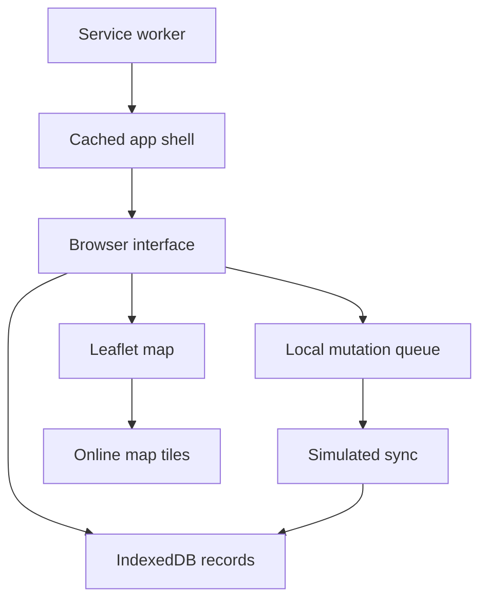

# ResQNet — Disaster Relief Coordination Prototype

**Connecting Help. Saving Lives.**

A browser-based academic prototype for emergency reports, rescue teams, relief resources, and shelters. It demonstrates local persistence and offline app-shell caching with IndexedDB and a service worker.

**JavaScript · IndexedDB · PWA · Leaflet · Tailwind CSS**

[Features](#features) · [Run locally](#run-locally) · [Offline demonstration](#offline-demonstration) · [Architecture](#architecture) · [Current limitations](#current-limitations)

> **Implementation status:** Offline records stay in the current browser. Synchronization with “Central Command” is simulated in `dist/js/sync.js`; this version does not send updates to a real backend or nearby devices.

## Features

- Dashboard with incident, team, resource, and facility summaries
- Emergency reporting with local storage and queue indicators
- Searchable reports with JSON/CSV export
- Rescue-team assignment and status controls
- Resource inventory adjustments and local audit logs
- Shelter and hospital capacity views
- Leaflet map with local vector overlays and an offline fallback
- Role-switching UI and an offline simulation toggle

## Run locally

Install Node.js, then:

```bash
git clone https://github.com/tejas764/FSD_LAbs.git
cd FSD_LAbs
npm start
```

Open **http://localhost:8080**. The included server uses Node built-ins and serves the committed assets. Use localhost or HTTPS for service-worker functionality; opening `index.html` as a file is insufficient.

### Rebuild styles

If you change Tailwind classes or source CSS:

```bash
npm install
npm run build:css
```

For continuous CSS compilation, use `npm run watch:css`.

## Offline demonstration

1. Open the app online and let the service worker cache the app shell.
2. Enable **Simulate Offline**, or disconnect through browser developer tools.
3. Add a sample emergency report and adjust a resource or team record.
4. Inspect the pending queue and confirm the data remains after reloading, once caching is ready.
5. Reconnect and trigger **Sync Now**.
6. Observe the simulated queue processing and local status changes.

The final step removes local queued entries and marks reports as synced. It does not confirm receipt by any remote service. Do not clear browser storage when you need to retain local records; export test records first.

## Architecture



The Node server is a static development server. IndexedDB is the application data store in this version; the role selector is UI state, not server-enforced authentication.

## Project structure

| Path | Purpose |
| --- | --- |
| [index.html](index.html) | Main page and application layout |
| [dist/js/](dist/js/) | Dashboard, map, reports, teams, resources, and facility modules |
| [dist/js/db.js](dist/js/db.js) | IndexedDB persistence |
| [dist/js/sync.js](dist/js/sync.js) | Offline queue and simulated synchronization |
| [dist/css/](dist/css/) | Compiled Tailwind and Leaflet styles |
| [src/css/input.css](src/css/input.css) | Tailwind source stylesheet |
| [sw.js](sw.js) | Service-worker caching |
| [manifest.webmanifest](manifest.webmanifest) | PWA metadata |
| [serve.js](serve.js) | Local static server |

## Current limitations

- No production backend, shared database, or cross-device synchronization.
- No Bluetooth, Wi-Fi Direct, LoRa, or offline peer-to-peer messaging.
- Offline map overlays do not provide a fully downloaded basemap; external map tiles depend on connectivity/cache.
- Roles are demonstration controls, not authorization boundaries.
- Sample scenarios and displayed operational statuses are demonstration data.
- This prototype has not established emergency-service readiness or standards certification.

## Development roadmap

Add authenticated APIs, a shared database, durable sync acknowledgements, conflict resolution, and multi-device tests before treating the application as a full-stack coordination system. Validate caching and accessibility on the intended devices.

## Credits and licensing

The package identifies the project as ResQNet Engineering and declares MIT. A standalone license text is not included in this repository; preserve third-party asset and library notices.
