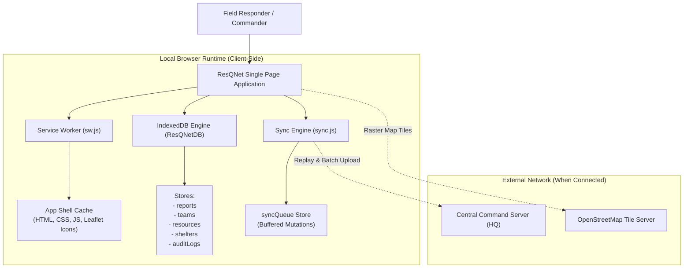

# ResQNet – Offline-First Disaster Relief Coordination System

> **"Connecting Help. Saving Lives."**  
> An academic progressive web application (PWA) designed for emergency responders, relief shelters, field hospitals, and incident commanders to coordinate life-saving disaster management operations without internet connectivity.

---

## 1. Project Overview & Motivation

During natural disasters (cyclones, flash floods, earthquakes, structural failures), cellular towers and fiber backhauls often fail immediately. Traditional cloud-dependent emergency portals become completely unreachable, leaving field rescue teams, community shelters, and trauma hospitals blind to local conditions and isolated from mutual support.

**ResQNet** solves this critical problem through an **offline-first architectural model**:
- **Autonomous Local Operations**: Field workers can report emergencies, reassign rescue boats, adjust medical inventories, and monitor hospital capacities entirely offline.
- **Zero-Dependency Styling & GIS**: Built with local, pre-compiled Tailwind CSS and bundled Leaflet.js with zero CDN dependencies.
- **Client-Side Persistence**: Complete transactional storage in browser **IndexedDB**.
- **Resilient Sync Engine**: Automatically tags mutations as `Pending Synchronization` while offline and seamlessly replays them to Central Command when connectivity is restored.
- **Tactical Vector GIS Fallback**: When external OpenStreetMap raster tile servers are unreachable, the system automatically activates a vector grid mode showing spatial coordinates, hazard polygons, evacuation corridors, and team locations.

---

## 2. Technology Stack

| Layer | Technology | Role & Architecture |
|---|---|---|
| **Structure & UI** | **HTML5 & CSS3** | Semantic layout, accessibility, and high-contrast emergency theme |
| **Styling** | **Tailwind CSS (Local CLI Build)** | Pre-compiled locally (`dist/css/styles.css`). **Zero CDN dependency** |
| **Logic** | **Vanilla JavaScript (ES6+ Modular)** | Lightweight, fast execution without bulky framework overhead |
| **Database** | **IndexedDB (`ResQNetDB`)** | ACID transactions across 6 stores: `reports`, `teams`, `resources`, `shelters`, `syncQueue`, `auditLogs` |
| **Caching & PWA** | **Service Workers (`sw.js`) & Manifest** | Cache-first strategy for app shell; installable as native desktop/mobile PWA |
| **Mapping & GIS** | **Leaflet.js & OpenStreetMap** | Local Leaflet distribution with offline tactical vector grid fallback |

---

## 3. System Architecture & Offline-First Flow



---

## 4. Key Modules & Layout

### A. Professional Emergency Header
- **ResQNet Branding & Tagline**: High-visibility emergency shield logo with "Connecting Help. Saving Lives."
- **DEFCON Alert Status**: Live Level 3 Severe Disaster Alert (Delta Coastal Basin scenario).
- **Online/Offline Connectivity Indicator**: Real-time status badge with **interactive "Simulate Offline" toggle** for instant demonstrations during academic evaluation.
- **Sync Queue Counter**: Real-time indicator displaying pending local mutations with inspector modal.
- **Role Switcher**: Switch between *Incident Commander*, *Field Responder*, and *Logistics Coordinator*.
- **Database Reset Button**: One-click restore to initial scenario dataset.

### B. Responsive Navigation Bar
- Seamless routing across: `Home`, `Dashboard`, `Disaster Map`, `Emergency Reports`, `Rescue Teams`, `Resource Management`, `Shelters & Hospitals`, and `About Architecture`.
- Mobile hamburger menu for small screens.

### C. Main Tactical Dashboard
- **4 Key Statistic KPI Cards**:
  1. **Active Emergencies**: Priority breakdown (Critical, High, Medium, Low).
  2. **Rescue Teams Available**: Available vs. deployed squads.
  3. **Registered Volunteers & Responders**: Active field personnel and specialized strike teams.
  4. **Available Relief Supplies**: Total stocked units with critical shortage alerts.
- **Priority Distribution Bar**: Real-time visual meters comparing incident severity.
- **Live Emergency Incident Feed**: Chronological activity stream with direct jump to details.

### D. Disaster Monitoring Map (Leaflet.js Tactical GIS)
- **Interactive Layers**: Disaster-affected markers, rescue teams, emergency evacuation shelters, and trauma hospitals.
- **Map Filters**: Toggle layers on/off independently.
- **Click-to-Report**: Click anywhere on the map to capture exact GPS coordinates directly into the emergency reporting form.
- **Offline Fallback Guarantee**: Displays clear tactical notice and keeps vector boundaries, inundation zones, and coordinate markers fully interactive without internet.

### E. Emergency Reporting Module
- **Comprehensive Incident Form**: Reporter name, radio channel, emergency category, location landmark, coordinates (with "Use GPS" and "Pick on Map" helpers), severity selection, number of affected people, and specific resource requisition tags.
- **Unique Report ID Generator**: Generates standardized IDs (e.g., `RQ-2026-1049`).
- **Immediate IndexedDB Persistence**: Reports are written to disk locally in milliseconds.
- **Pending Sync Tagging**: Automatically tagged as `Pending Synchronization` when offline.

### F. Emergency Reports Table
- Filterable and searchable table with columns for ID, Severity, Category, Location, People Affected, Status update dropdown, Sync badge, and actions.
- **Export Capabilities**: One-click export to **JSON** (emergency backup) and **CSV** (incident analysis spreadsheet).

### G. Rescue Team Management
- Grid of active emergency teams (NDRF Swift Water, Coast Guard Marine Patrol, Civil Defense Heavy Shoring, Red Cross Mobile ICU, Volunteer SAR, and Aviation Heli-Evac).
- Live member counts, assigned zones, radio frequencies, and operation statuses.
- **Operational Updates**: Modal to reassign zones, change availability, and dispatch teams to emergency incidents.

### H. Resource Management
- Relief inventory: Ready-to-eat food rations, potable drinking water, trauma medicine kits, first-aid packs, inflatable rescue boats, portable generators, survival blankets, and purification tablets.
- Visual stock progress bars with minimum safety thresholds.
- **Functional Adjustments**: Quick `+10`, `+50`, `-10`, `-50` adjustments with reason logging stored in the local audit trail.

### I. Shelters & Field Hospitals
- Facility profiles showing occupancy meters, ICU bed availability, power sources, water security, and officer contacts.
- Live capacity update controls.

---

## 5. How to Run the Project Locally

Because ResQNet uses modern **Service Workers** and **PWA features**, it must be served over `http://localhost` (or HTTPS).

### Step 1: Open Terminal in Project Directory
```powershell
cd C:\Users\91853\.gemini\antigravity\scratch\resqnet
```

### Step 2: Start the Included Local Server
```bash
npm start
```
The server will start at:
```
http://localhost:8080
```

### Step 3: Open in Any Modern Browser
Navigate to `http://localhost:8080` in Chrome, Edge, Firefox, or Safari.

---

## 6. Offline Demonstration Guide (For Viva / Evaluation)

To demonstrate the offline-first architecture during an academic evaluation:

1. **Step 1 - Normal Online Operation**:
   - Open the application at `http://localhost:8080`.
   - Observe the green `ONLINE` status indicator in the top header.
   - Note the statistics and map markers loaded from IndexedDB.

2. **Step 2 - Simulate Network Blackout**:
   - Toggle the **"Simulate Offline"** switch in the top header (or disconnect your computer's Wi-Fi / set Chrome DevTools Network to "Offline").
   - Notice the status badge switches to a red pulsing **`OFFLINE (Simulated)`** badge, and the yellow offline guidance banner appears.

3. **Step 3 - Submit an Emergency Report While Offline**:
   - Go to **Emergency Reports** (`#reports`).
   - Fill out an incident report (e.g., "Bridge approach collapse, 25 stranded").
   - Click **Submit Emergency Report**.
   - Notice the report is immediately saved to **IndexedDB**, given a unique ID (`RQ-2026-XXXX`), and tagged with a glowing amber badge: **`Pending Sync`**.
   - The header **Queue** counter increments from `0` to `1`.

4. **Step 4 - Perform Inventory & Team Updates Offline**:
   - Go to **Resource Management** (`#resources`) and deduct 50 units of Drinking Water.
   - Go to **Rescue Teams** (`#teams`) and deploy a standby team.
   - The queue counter increments to reflect each offline mutation.

5. **Step 5 - Inspect the Offline Queue**:
   - Click the **Queue** pill in the header to open the *Offline Synchronization Queue Modal*.
   - Review the queued mutations waiting in IndexedDB.

6. **Step 6 - Reconnect & Synchronize**:
   - Uncheck the "Simulate Offline" toggle (or reconnect Wi-Fi).
   - Click **Sync Now** (or observe automatic sync trigger).
   - Watch the synchronization animation process each queued mutation, transition the report status from `Pending Sync` to `Synced`, and log the audit entry!

---

## 7. Rebuilding Tailwind CSS (Optional)

If you modify classes in `index.html` or `dist/js/**/*.js`, re-compile the CSS using:
```bash
npm run build:css
```
This compiles the minified stylesheet locally into `dist/css/styles.css` without relying on any external CDN.

---

## 8. Academic Project Credits

- **Project**: ResQNet – Offline-First Disaster Relief Coordination System
- **Focus**: Human-Centered Disaster Informatics & Resilient PWA Architecture
- **Standard**: Follows ISO-22320 Emergency Management Guidelines

