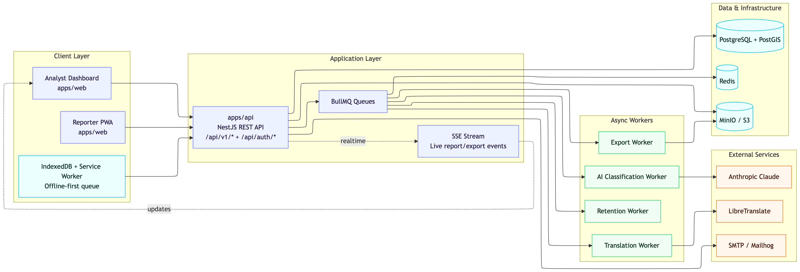

# ResQNet — Disaster Response Workspace

A disaster response application for community incident reporting, offline field
notes, personal preparedness, and authenticated volunteer coordination. Reporters
share geolocated observations; coordinators verify volunteers, offer assignments,
schedule shifts, and review completed work before approving volunteer hours.

This branch contains the Next.js/NestJS workspace. It replaces the static
prototype’s root startup workflow; the application runs on port **3000** with its
API on port **4000**. Follow the root-level setup commands below. See the
[integration and offline testing guide](docs/online-offline-integration.md) for
shared storage, recovery packets, and production offline use.

Volunteer registration and sign-in are available at `/volunteer/register` and
`/volunteer/login`, with the volunteer dashboard at `/volunteer` and the
administrator coordination workspace at `/dashboard/volunteers`. See the
[volunteer workspace guide](docs/volunteer-workspace.md) for setup, verification,
assignments, shifts, safety check-ins, and testing. The [AI request log](docs/ai-request-log.md)
documents the evaluation tab at `/ai-logs` and its export scope.

[Repository](https://github.com/tejas764/FSD_LAbs) ·
[CI workflow](.github/workflows/ci.yml) ·
[API deployment configuration](.github/workflows/deploy-api.yml) ·
[MIT license](LICENSE)

---

## Table of Contents

- [Apps](#apps)
- [Features](#features)
- [Prerequisites](#prerequisites)
- [Quick Start](#quick-start)
- [Architecture](#architecture)
- [Accessibility (WCAG 2.1 AA)](#accessibility-wcag-21-aa)
- [Scale Validation (250k and 500k)](#scale-validation-250k-and-500k)
- [Local Test Access](#local-test-access)
- [Development](#development)
- [CI / CD](#ci--cd)
- [Contributing](#contributing)
- [Security](#security)
- [License](#license)

---

## Apps

| App | Stack | Serves | Local runtime / hosting | README |
|---|---|---|---|---|
| `apps/web` | Next.js 16 PWA | Community (`/`), volunteers (`/volunteer/*`), coordinators (`/dashboard/volunteers`), staff (`/dashboard/*`), evaluation (`/ai-logs`) | `localhost:3000`; configure frontend hosting separately | [apps/web/README.md](apps/web/README.md) |
| `apps/api` | NestJS 11 | REST API and authentication (`/api/v1/*`) | `localhost:4000`; ECS deployment templates are supplied | [apps/api/README.md](apps/api/README.md) |

---

## Features

- **Offline-first reporter** — submit damage reports with no connectivity; syncs automatically when back online
- **Multi-step wizard** — damage level, infrastructure type, GPS/text location, photo upload with EXIF stripping
- **Anonymous reporting** — no account required to submit; idempotency key prevents duplicates
- **Live analyst dashboard** — Leaflet map, KPIs, daily trend, moderation queue, export
- **H3 hotspot analytics** — geospatial clustering of damage density for priority triage
- **Async AI classification** — Anthropic Claude classifies damage level from photos without blocking submission
- **Multilingual** — 6 UN languages (ar, zh, en, fr, ru, es) with RTL layout support
- **Accessibility-first UX** — WCAG 2.1 AA target with zero axe violations required in CI
- **Async export** — CSV / GeoJSON export of any crisis dataset via BullMQ + SSE delivery
- **Role-based access** — anonymous reporters, authenticated analysts, and admins
- **Versioned reports** — same building reported over time; newest version is primary; full history preserved
- **Scale-ready API** — validated for 250k and 500k dataset scenarios in tests and benchmark tooling
- **Volunteer workspace** — registration, profile management, availability, eligible tasks, assignment responses, progress, completion reports, shifts, and safety check-ins
- **Coordinator review** — administrator-controlled verification and approved volunteer hours
- **Evaluation request log** — original available user requests with search, copy, and complete JSON/text exports

---

## Prerequisites

| Requirement | Version |
|---|---|
| Node.js | 24.14.1 (pinned in `.node-version`) |
| npm | bundled with Node |
| Docker + Compose | for all local infrastructure services |

---

## Quick Start

### 1. Prepare the workspace

```bash
git clone --branch newversion https://github.com/tejas764/FSD_LAbs.git
cd FSD_LAbs
npm run setup
npm run infra:up
npm run db:deploy
npm --prefix apps/api run seed
npm run dev
```

Run these commands from the repository root. On Windows PowerShell with script
execution disabled, use `npm.cmd` in place of `npm`. `setup` installs both apps,
generates the Prisma client, and creates missing `.env.local` files from the
examples without overwriting existing configuration. `db:deploy` applies the
checked-in migrations. Seeding prepares local test accounts and crisis data.

`dev` starts both servers; Ctrl+C stops both. Open **http://localhost:3000**.
Register a volunteer at `/volunteer/register`, or use the seeded administrator
account described in the app documentation to coordinate volunteers.

### 2. Local services

| Service | URL | Purpose |
|---|---|---|
| PostgreSQL + PostGIS | localhost:5432 | Database |
| Redis | localhost:6379 | BullMQ queues |
| MinIO | localhost:9001 | Object storage (photos, exports) |
| LibreTranslate | localhost:5000 | Translation API |
| Mailhog | localhost:8025 | Email preview |

### 3. Production-mode local run

```bash
npm run build
npm start
```

Keep the local infrastructure running. A production build is required to test
the public offline service worker. The authenticated volunteer and coordinator
workspaces require their private API connection. Publishing this branch to GitHub
does not deploy a running application; configure hosting separately.

---

## Architecture



- General report APIs use `apps/web/lib/api/client.ts`; volunteer requests use
  `apps/web/lib/volunteer-api.ts`, with coordinator requests scoped to the admin
  workspace. Browser requests use the same-origin API proxy.
- `apps/api` owns the Prisma schema and all migrations.
- `docs/openapi.yaml` is the canonical API contract — the CI/CD deploy gate fails if it is stale.

See [docs/architecture-split.md](docs/architecture-split.md) for the full architecture breakdown.

---

## Accessibility (WCAG 2.1 AA)

- WCAG 2.1 AA compliance is a hard requirement for all shipped UI.
- Zero axe-core violations are required before components can merge.
- The shared reporting interface includes six language resources and RTL support;
  the new volunteer and evaluation workflows currently use English copy.
- Accessibility checks are part of regular frontend testing in `apps/web`.

---

## Scale Validation (250k and 500k)

- API analytics and export paths are validated for high-volume datasets at 250,000 and 500,000 rows.
- Scale scenarios are covered by automated tests and benchmark tooling in `apps/api`.
- Performance and throughput verification is part of the backend test strategy before release.

---

## Local Test Access

- Public reporter flow is available without login at `/`.
- For dashboard role testing (`admin`, `analyst`, `viewer`), use seeded local accounts documented in `apps/web/README.md`.

---

## Development

```bash
# Run tests
npm --prefix apps/api test
npm --prefix apps/api run test:e2e
npm --prefix apps/web test
npm --prefix apps/web run test:e2e

# Type-check both apps
npm run type-check
```

### Rules (non-negotiable)

- **TDD** — write failing test first, then minimum code
- **a11y** — zero axe violations on all components (blocks CI)
- **i18n** — all user-visible text via `t()`, all 6 locales updated
- **No `console.log`** — use the app logger
- **No `git add -A`** — stage by explicit path only

### Commit format

```
<type>: <short description>
```

Types: `feat` `fix` `test` `a11y` `i18n` `perf` `docs` `refactor` `chore`

---

## CI / CD

| Workflow | Trigger | Configuration | What it does |
|---|---|---|---|
| `ci.yml` | Pushes and pull requests targeting `main` | [CI definition](.github/workflows/ci.yml) | Lint, type-check, unit + e2e tests for both apps |
| `deploy-api.yml` | Push to `main` touching `apps/api/**` or `infra/**` | [API deployment definition](.github/workflows/deploy-api.yml) | Test gates, image build, and ECS deployment when the required cloud configuration is supplied |
| `release-please.yml` | Push to `main` | [Release definition](.github/workflows/release-please.yml) | Opens release PRs with changelogs and version updates |

These files describe the available workflows; they do not establish a hosted
deployment or a successful CI run for this branch. Configure your own frontend
hosting, API infrastructure, repository secrets, and allowed origins before
deployment. See [docs/deployment-api.md](docs/deployment-api.md) for the API setup.

---

## Contributing

Contributions are welcome from the community.

1. Open an issue describing the bug, feature, or improvement.
2. Create a branch from `dev`.
3. Follow mandatory quality rules (TDD, a11y, i18n) and run tests locally.
4. Use explicit staging (`git add <path>`) and conventional commit format.
5. Open a PR with clear scope, rationale, and verification evidence.

Before opening a PR, run:

```bash
npm --prefix apps/api run lint
npm --prefix apps/api run type-check
npm --prefix apps/api test
npm --prefix apps/web run lint
npm --prefix apps/web run type-check
npm --prefix apps/web test
```

---

## Security

For security-sensitive issues, avoid posting full exploit details in public issues.
Use GitHub's private vulnerability reporting for this repository when available.

---

## License

MIT
