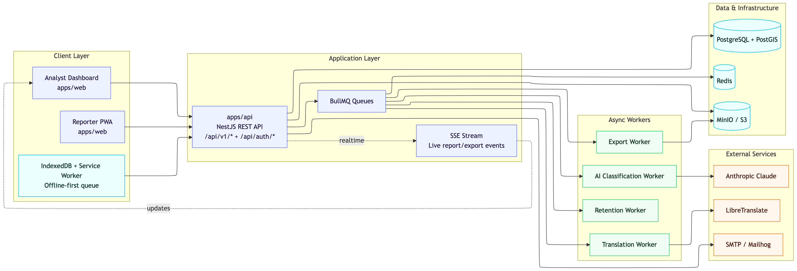

# CrisisMap Split Architecture

This document explains how CrisisMap is split into frontend and backend services, and why this architecture was chosen for reliability at disaster-response scale.

## Architecture diagram

## System boundaries

- `apps/web` (Next.js 16): reporter and dashboard user interfaces.
- `apps/api` (NestJS 11): all API endpoints under `/api/v1/*`, auth verification, queue workers, and data access.
- `docs/openapi.yaml`: canonical API contract.
- `apps/api/prisma`: canonical schema and migrations.

## Why split the system

- Isolates user-facing rendering from backend workloads.
- Prevents heavy jobs (translation/export/classification) from degrading submission latency.
- Enables independent scaling:
  - `apps/web` scales for read-heavy traffic and map usage.
  - `apps/api` scales for write bursts and worker throughput.

## Request flow

1. Reporter submits damage form in `apps/web`.
2. Frontend sends request to `apps/api` (`POST /api/v1/reports`).
3. API validates, writes primary report row, returns quickly.
4. Async workers process classification, translation, and exports in BullMQ.
5. Dashboard consumes API list/filter endpoints and realtime stream updates.

## Data ownership and migration policy

- Prisma schema and migrations are owned only by `apps/api`.
- `apps/web` never runs migrations and never defines backend routes.
- DB changes are made through migration files in `apps/api/prisma/migrations`.

## Offline-first reporter behavior

- Reporter flow stores submissions in IndexedDB first.
- Sync retries when connectivity returns.
- Service worker events trigger queue draining and refresh.

## Security and compliance boundaries

- API enforces auth, roles, throttling, and signed export URLs.
- Admin-sensitive actions are audit logged.
- Frontend only uses typed API clients and does not bypass backend controls.

## Performance and scale posture

- Target scenario evidence includes 50k, 250k, and 500k report volumes.
- `/reports` list p95 target is validated at 500k.
- Query/index tuning is applied in API migrations and services, not in frontend logic.

## Operational model

- Local development uses Docker Compose for Postgres/PostGIS, Redis, MinIO, LibreTranslate, and Mailhog.
- Deployments can place `apps/web` and `apps/api` on separate compute planes with independent autoscaling.
